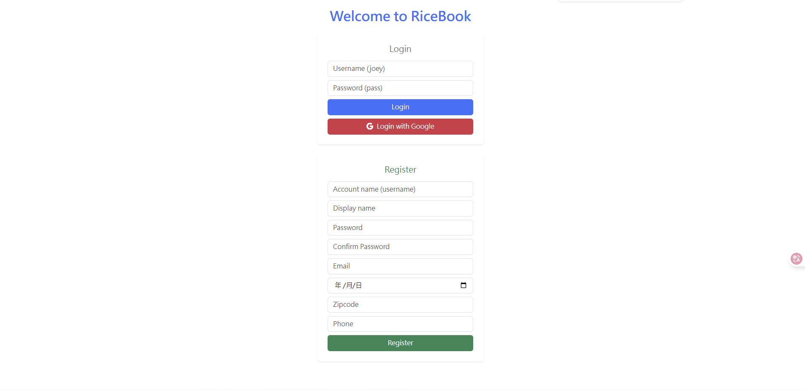
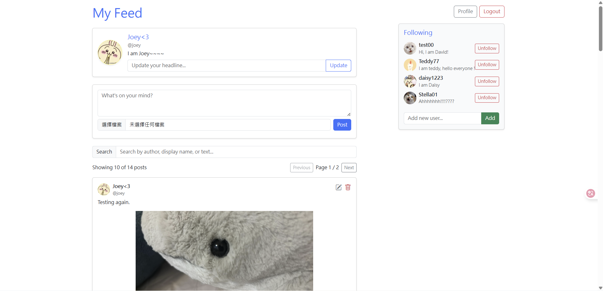
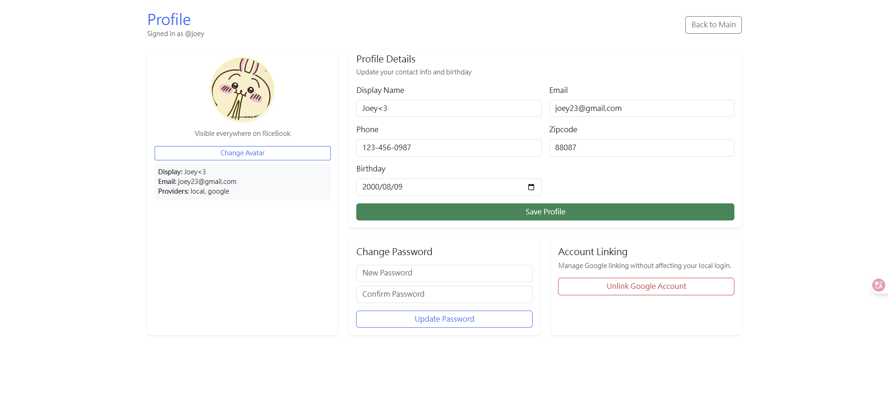

# Final - RiceBook Frontend
**Deployed URL:** https://yh167-hw5.surge.sh  
- **Test User:** `joey`
- **Password:** `pass`

---

# RiceBook Frontend

This folder contains the **React + TypeScript** implementation of the RiceBook frontend application.  
It provides all client-side logic, user interface components, routing, and API interactions with the backend server.

---

## 🚀 Running the Frontend
```
npm install

npm start
```

## Pages
- **Landing Page:** User registration & login  
- **Main Page:** Posts feed, search, add/remove followers  
- **Profile Page:** Editable user info & avatar upload

## ✨ Frontend Features
- Built with React + TypeScript
- Client-side routing using React Router
- Cloudinary-based image uploads
- API integration with Express backend
- User authentication UI
- Profile editing UI
- Posting & following UI

## 🛠️ Tech Stack
- React (TypeScript)
- React Router
- Cloudinary Upload API
- Fetch / Axios for backend communication




